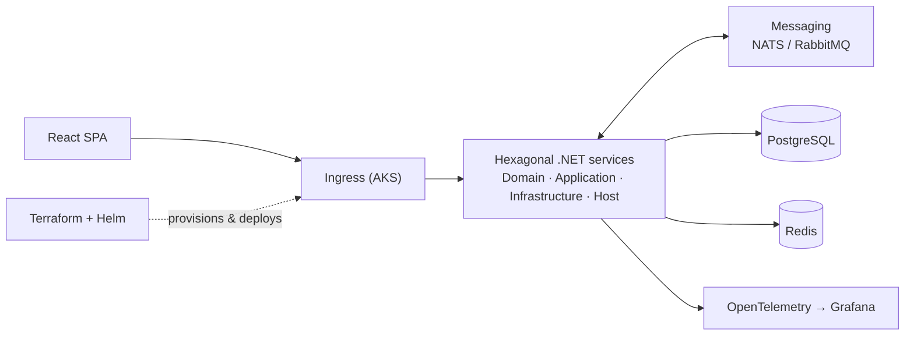
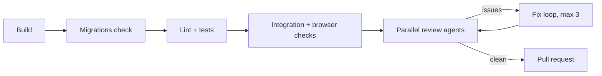

# cloudstack-ai-plugins

[](LICENSE)
[](https://dotnet.microsoft.com/)
[](https://react.dev/)
[](https://www.terraform.io/)

**A reference architecture for cloud web apps, and the Claude Code workflow that builds and ships it.**

You get an architecture that holds up in production: hexagonal .NET services, a React frontend, and Terraform + Helm on Azure/AKS. You also get Claude Code plugins that build within that architecture at every step, from the first requirement to a deployed service. Claude scaffolds code that fits the layers, checks the rules on every change, reviews before every PR, and shows you the plan before anything is applied to the cloud.

## The architecture



- **Backend:** each service has strict layers (Domain depends on nothing), CQRS commands and queries, `Result<T>` instead of exceptions, and EF Core with mandatory migrations.
- **Frontend:** feature modules with a central API client, server state in TanStack Query (or your library), and security defaults.
- **Cloud:** Terraform/Terragrunt modules, one Helm chart per service, GitHub Actions, trivy security scans, and plan-before-apply.

The full picture, including layer rules, the CQRS flow and the cloud topology, is in [docs/architecture.md](docs/architecture.md).

## The workflow

| Stage | What Claude does | Commands |
|---|---|---|
| **Plan** | Turns an idea into requirements, tasks and GitHub issues | `/dev-workflow:prd`, `/dev-workflow:plan-feature`, `/dev-workflow:create-tasks` |
| **Build** | Branches from the issue and scaffolds code that fits the architecture | `/dev-workflow:start-work 42`, `/dotnet-architect:add-entity`, `/dotnet-architect:add-command`, `/react-developer:add-feature` |
| **Verify** | Checks architecture rules, runs affected tests, checks pages in a browser | `/dotnet-architect:check-architecture`, `/dev-workflow:run-tests`, `/react-developer:verify-feature` |
| **Ship** | Builds, lints and tests, runs parallel review agents, fixes issues, opens the PR | `/dev-workflow:complete-task` |
| **Deploy** | Scaffolds infra, lints and scans it, shows the plan, applies the reviewed plan | `/cloud-infra:add-terraform-module`, `/cloud-infra:add-helm-chart`, `/cloud-infra:complete-infra`, `/cloud-infra:infra-apply` |

Each plugin also ships convention skills, such as the domain-layer rules, the endpoint conventions and frontend security. Claude applies them automatically whenever it edits matching files, so the architecture holds even outside the commands.

## Install

```
/plugin marketplace add makigjuro/cloudstack-ai-plugins
/plugin install dev-workflow@cloudstack-ai-plugins
/plugin install dotnet-architect@cloudstack-ai-plugins
/plugin install react-developer@cloudstack-ai-plugins
/plugin install cloud-infra@cloudstack-ai-plugins
```

Then run `/dev-workflow:init` in your project. It detects your layout and writes a `cloudstack.json` with your paths, namespaces and conventions. Starting from scratch works too: the scaffolding skills create the structure as you go. Each plugin also works on its own.

| Plugin | Covers |
|---|---|
| [dev-workflow](plugins/dev-workflow/) | Requirements → issues → branch → quality gates → PR, plus diagnosis and docs |
| [dotnet-architect](plugins/dotnet-architect/) | Hexagonal .NET services, CQRS, EF Core migrations, tests, architecture review |
| [react-developer](plugins/react-developer/) | React + TypeScript feature modules, Playwright smoke tests and screenshots |
| [cloud-infra](plugins/cloud-infra/) | Terraform/Terragrunt modules, Helm charts, trivy scans, infra review |

## What `complete-task` checks



Only what changed gets checked: a frontend-only change skips the .NET build. The review agents cover security and architecture, acceptance criteria, stale docs, frontend and infrastructure. With Claude Code's Workflow tool, each finding is checked adversarially before it can block the PR.

## Docs

- [Getting started](docs/getting-started.md)
- [Reference architecture](docs/architecture.md)
- [cloudstack.json reference](docs/cloudstack-json-reference.md)
- [Writing plugins and skills](docs/plugin-development.md)

## Contributing

Issues and PRs are welcome. See [CONTRIBUTING.md](CONTRIBUTING.md). If this helps you ship, a ⭐ helps others find it.

## License

[MIT](LICENSE)
