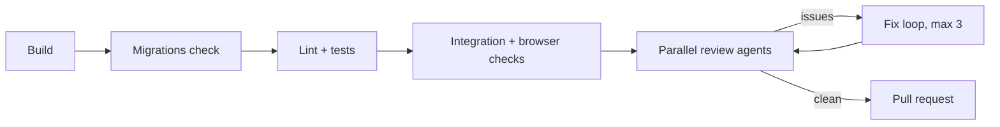

# cloudstack-ai-plugins

[](LICENSE)
[](https://dotnet.microsoft.com/)
[](https://react.dev/)
[](https://www.terraform.io/)

**Claude Code plugins that take a GitHub issue to a reviewed pull request on a .NET + React + Terraform stack.**

```
/dev-workflow:start-work 42      # branch from issue #42 and start building
/dev-workflow:complete-task      # build, lint, test, review, open the PR
```

In between, Claude follows your architecture instead of guessing. It scaffolds hexagonal .NET services, React feature modules, Terraform modules and Helm charts. It then reviews the result in parallel for security, architecture, acceptance criteria and stale docs.

## Install

```
/plugin marketplace add makigjuro/cloudstack-ai-plugins
/plugin install dev-workflow@cloudstack-ai-plugins
```

Add the plugins for your stack:

```
/plugin install dotnet-architect@cloudstack-ai-plugins
/plugin install react-developer@cloudstack-ai-plugins
/plugin install cloud-infra@cloudstack-ai-plugins
```

Then run `/dev-workflow:init` in your project. It detects your layout and writes a `cloudstack.json`. The file is optional; without it the plugins auto-detect paths.

## What you get

| Plugin | For | Try |
|---|---|---|
| [dev-workflow](plugins/dev-workflow/) | Issue → branch → PR, with quality gates | `/dev-workflow:prd`, `/dev-workflow:complete-task`, `/dev-workflow:diagnose` |
| [dotnet-architect](plugins/dotnet-architect/) | Hexagonal .NET microservices, CQRS, EF Core | `/dotnet-architect:add-entity Order OrderService`, `/dotnet-architect:check-architecture` |
| [react-developer](plugins/react-developer/) | React + TypeScript features, Playwright checks | `/react-developer:add-feature orders`, `/react-developer:verify-feature` |
| [cloud-infra](plugins/cloud-infra/) | Terraform, Terragrunt, Helm, trivy | `/cloud-infra:add-helm-chart order-service`, `/cloud-infra:infra-plan` |

Each plugin also ships background convention skills, such as the domain-layer rules, the endpoint conventions and frontend security. Claude applies them automatically when it edits matching files.

## How `complete-task` works



Only what changed gets checked. A frontend-only change skips the .NET build, and the infra reviewer runs only when Terraform, Helm or CI files change. With Claude Code's Workflow tool, the review agents return structured findings, and each finding is checked adversarially before it can block the PR.

## Stack

- **Backend:** .NET 10, hexagonal architecture, CQRS, EF Core, WolverineFx, FluentValidation
- **Frontend:** React 19, TypeScript, TanStack Query or your choice of state libraries, shadcn/ui
- **Infra:** Terraform/Terragrunt, Helm, Azure/AKS, GitHub Actions, .NET Aspire or Docker Compose locally

Paths, namespaces and conventions come from [`cloudstack.json`](docs/cloudstack-json-reference.md), so the plugins adapt to an existing repo instead of forcing a layout.

## Docs

- [Getting started](docs/getting-started.md)
- [Reference architecture](docs/architecture.md): layers, CQRS flow, cloud topology
- [cloudstack.json reference](docs/cloudstack-json-reference.md)
- [Writing plugins and skills](docs/plugin-development.md)

## Contributing

Issues and PRs are welcome. See [CONTRIBUTING.md](CONTRIBUTING.md). If the plugins save you time, a ⭐ helps others find them.

## License

[MIT](LICENSE)
